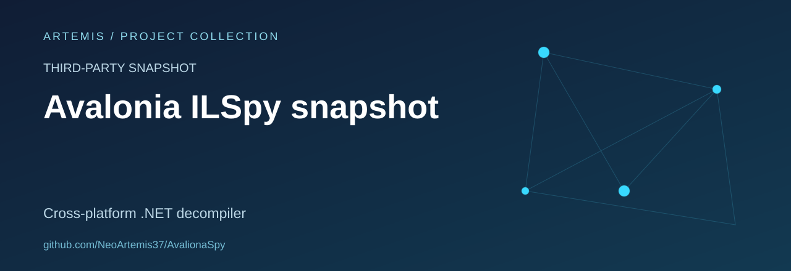

# AvalionaSpy

A preserved copy of **AvaloniaILSpy**, the cross-platform .NET decompiler interface built with Avalonia.

**Status:** third-party source snapshot. This repository is not the upstream project and does not claim authorship of ILSpy or AvaloniaILSpy.

## Provenance

The existing source and README identify [icsharpcode/AvaloniaILSpy](https://github.com/icsharpcode/AvaloniaILSpy) as the original project. Its archival notice explains that upstream maintenance ended and points readers to [ILSpy for VS Code](https://github.com/icsharpcode/ilspy-vscode).

Please use upstream documentation for supported versions and current releases. No new release or support commitment is made by this copy.

## What is included

- The `ILSpy.sln` solution and decompiler-related projects.
- The `SharpTreeView/` interface components.
- A `TestPlugin/` example and documentation under `doc/`.
- Existing preview artwork and historical build outputs.

## Repository notes

This is an archive for source reading and learning about desktop application architecture. The checked-in `bin/` and `obj/` outputs are historical artefacts, not verified release packages.

## Credits and licences

Credit belongs to the ILSpy and AvaloniaILSpy contributors and the other projects named in their source notices. Preserve the copyright and licence files under `doc/`, `SharpTreeView/` and the source tree when reusing material. The name of this repository does not replace those notices.
